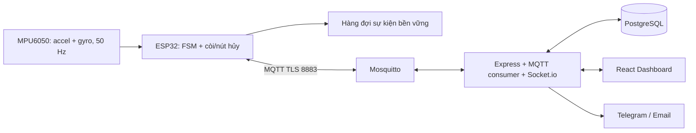

# Smart Fall-Guard Wristband

Dự án Bài tập lớn IoT — Nhóm 4, GEHIHI. Kế hoạch triển khai: 01/11–30/11/2026.

> **Trạng thái: khung dự án, chưa có bản chạy đầu-cuối.** Firmware chưa đọc cảm biến/chạy FSM; MQTT, CSDL, Socket.io, webhook và dashboard còn là khung. Các tính năng dưới đây là thiết kế mục tiêu. Chưa có kết quả đo độ chính xác, độ trễ hoặc thời lượng pin.

## 1. Kiến trúc mục tiêu



- ESP32 tiếp tục phát hiện và báo tại chỗ khi mạng mất; reconnect phải không chặn vòng lấy mẫu 20 ms.
- PostgreSQL là CSDL duy nhất của bản đầu. Heartbeat chạy trong tiến trình backend khi được triển khai; chưa cần một daemon độc lập.
- MQTT có tài khoản riêng theo device_id; frontend dùng REST/Socket.io qua backend, không kết nối broker trực tiếp.
- Chỉ xóa sự kiện offline sau ACK của backend xác nhận đã commit CSDL. QoS 1 có thể phát trùng; cần chống trùng theo event_id.
- Mất Wi-Fi/broker: cảnh báo từ xa bị trì hoãn đến khi nối lại; buffer chỉ bảo toàn lịch sử trong giới hạn dung lượng và nguồn điện.

Xem [quyết định kiến trúc và thứ tự triển khai](docs/ARCHITECTURE_REVIEW.md), [đặc tả MQTT](docs/MQTT_TOPICS_SPEC.md) và [API dự kiến](docs/API_DOCUMENTATION.md).

## 2. Thuật toán phát hiện ngã dự kiến

MPU6050 được cấu hình dải gia tốc **±8 g**, khi đó raw / 4096.0 mới ra đơn vị g. Tần số đọc mục tiêu 50 Hz; cần cấu hình bộ lọc, hiệu chuẩn offset và log cả ba trục gyro.

`SVM = sqrt(ax² + ay² + az²)`. Góc tính bằng atan2 từ gia tốc là góc của cảm biến ở điều kiện gần tĩnh, chưa phải bộ lọc bù hay tư thế toàn thân. Bộ lọc bù cần kết hợp gyro, dt và hiệu chuẩn; không dùng góc gia tốc tại va chạm như một tư thế đáng tin cậy.

FSM bản nền:

1. IDLE → FREE_FALL: SVM < 0,5 g.
2. FREE_FALL → IMPACT: SVM > 2,8 g trong 500 ms.
3. IMPACT → POSTURE_CHANGE: xét thay đổi hướng cảm biến >45° trong cửa sổ hậu va chạm.
4. POSTURE_CHANGE → INACTIVITY: xét biến thiên theo cửa sổ của gia tốc và gyro; mục tiêu bất động 3 giây.
5. LOCAL_ALARM: còi/LED, cho người đeo 15 giây để bấm hủy.
6. CONFIRMED_FALL: tạo event_id, ghi hàng đợi bền vững rồi gửi MQTT; retry cùng ID đến khi backend ACK.

Đây là ngưỡng khởi đầu cần thu dữ liệu để hiệu chỉnh. Mỗi trạng thái cần timeout/reset, debounce nút hủy và kiểm thử thời điểm sát hạn. Nhánh bắt buộc rơi tự do có thể bỏ sót ngã khuỵu/ngã chậm; cần thu dữ liệu để đánh giá nhánh phát hiện bổ sung. Cổ tay cử động độc lập với thân người nên phải kiểm chứng trên đúng vị trí đeo.

**Độ trễ từ va chạm đến cảnh báo từ xa gồm thời gian xét tư thế, bất động 3 giây, chờ hủy 15 giây và thời gian truyền. Mục tiêu ≤2 giây chỉ áp dụng từ CONFIRMED_FALL đến khi dashboard hiển thị.**

## 3. Phần cứng và nguồn điện

Xem [danh sách linh kiện, tiêu chí mua và đấu nối](docs/HARDWARE_BOM.md).

Đã có [sơ đồ EasyEDA USB Rev A và file nguồn chỉnh sửa](docs/hardware/README.md) cho bản lắp thử.

| Chức năng | GPIO ESP32 | Ghi chú |
|---|---|---|
| MPU6050 SDA / SCL | 21 / 22 | Pull-up I²C lên 3,3 V; kiểm tra module |
| MPU6050 AD0 | GND | Địa chỉ 0x68 |
| Nút hủy | 18 → nút → GND | INPUT_PULLUP, debounce |
| Buzzer thụ động | 19 → mạch driver | PWM 2 kHz; không cấp tải còi trực tiếp tùy tiện |
| LED ngoài | 23 → điện trở → LED → GND | Tránh thêm tải ngoài vào chân boot strap GPIO2 |

Thử nghiệm ban đầu dùng USB. Nguồn pin mục tiêu:

```text
USB 5 V → mạch sạc có power path ← pin Li-Po 1S có bảo vệ
                    ↓ SYS
            buck-boost 3,3 V
                    ↓
              ESP32 + cảm biến
```

Không dùng phương án pin 1S → AMS1117-3.3 V; không cấp pin 3,7–4,2 V trực tiếp vào chân 3V3. Phải kiểm tra cách cấp nguồn của đúng bo mua về, tránh cấp USB và nguồn ngoài đồng thời khi chưa có cách ly phù hợp.

## 4. KPI cần đo

| Chỉ số | Mục tiêu / định nghĩa | Kết quả |
|---|---|---|
| Truyền cảnh báo sau xác nhận | CONFIRMED_FALL → dashboard ≤2 giây khi online | Chưa đo |
| Cảnh báo từ lúc va chạm | Ghi riêng tổng thời gian, bao gồm 3 giây bất động + 15 giây hủy | Chưa đo |
| Recall | TP / (TP + FN) ≥90% trong bộ thử đã mô tả | Chưa đo |
| Tỷ lệ báo giả trong bộ thử | FP / (FP + TN) <10%; bổ sung số báo giả/giờ đeo | Chưa đo |
| Đồng bộ offline | Nhận đủ và không trùng 10/10 sự kiện thử, ACK sau commit | Chưa đo |
| Thời lượng pin | Mong muốn ≥24 giờ; dung lượng chốt sau đo dòng | Chưa đo |
| Phát hiện offline | Mục tiêu ≤15 giây; đo riêng LWT và timeout heartbeat | Chưa đo |

Pin 400 mAh chạy 24 giờ đòi hỏi dòng trung bình lý tưởng ≤16,7 mA trước tổn hao/dung lượng dự phòng; chưa có phép đo chứng minh DevKit đạt được. Không suy ra thời lượng thực từ dòng deep sleep khi thiết bị cần lấy mẫu liên tục.

Các báo cáo [pin](docs/BATTERY_BENCHMARK_REPORT.md), [hạ tầng](docs/INFRA_TEST_REPORT.md) và [50 ca thử](docs/TEST_CASES_50_FALLS.md) là mẫu ghi nhận. Các tệp hardware_schematic.png/.pdf, ui_wireframe.png và LATENCY_TEST_RESULTS.xlsx hiện rỗng, chưa dùng làm bằng chứng. Xem [quy trình đo độ trễ](docs/LATENCY_TEST_PLAN.md).

## 5. Thiết lập môi trường phát triển

Yêu cầu: Node.js 22, Docker Desktop đang chạy Linux containers. Chạy các lệnh PowerShell từ thư mục gốc repo.

```powershell
Copy-Item .env.example .env
```

Đặt POSTGRES_PASSWORD và MQTT_PASSWORD riêng trong .env. Backend đọc .env ở gốc repo; Compose dùng POSTGRES_* để khởi tạo PostgreSQL.

Tạo file mật khẩu broker lần đầu; mỗi lệnh hỏi mật khẩu tương tác, không ghi mật khẩu vào Git:

```powershell
# Chỉ dùng -c khi broker/passwd chưa tồn tại: -c tạo mới và ghi đè file cũ.
docker run --rm -it --mount "type=bind,source=$PWD/broker,target=/work" eclipse-mosquitto:2 mosquitto_passwd -c /work/passwd fallguard_backend
docker run --rm -it --mount "type=bind,source=$PWD/broker,target=/work" eclipse-mosquitto:2 mosquitto_passwd /work/passwd esp32_001
docker compose config --quiet
docker compose up -d
```

Mật khẩu fallguard_backend phải khớp MQTT_PASSWORD trong .env. Tạo tài khoản riêng cho mỗi thiết bị, username bằng device_id; dành riêng username fallguard_backend cho server.

Cấu hình mặc định chỉ xuất MQTT 1883 và PostgreSQL 5432 lên **127.0.0.1**. MQTT có mật khẩu/ACL nhưng chưa mã hóa ở chế độ local. Dữ liệu broker/CSDL dùng named volumes; schema chỉ tự khởi tạo khi PostgreSQL có data directory rỗng. Với volume đã có dữ liệu, cần migration riêng; không xóa volume để cập nhật schema.

```powershell
Push-Location backend
npm install
npm start
Pop-Location

# Chạy frontend trong terminal khác
Push-Location frontend
npm install
npm run dev
Pop-Location
```

Các lệnh trên chạy khung backend và trang React ban đầu; API nghiệp vụ và luồng cảnh báo chưa được triển khai. Nạp sketch hiện tại cũng chưa tạo chức năng phát hiện ngã.

Khi gắn ESP32 qua LAN, dùng [hướng dẫn TLS](docs/DEPLOYMENT.md) và Compose override; chưa mở API ra ngoài cho đến khi có xác thực/phân quyền. Chứng chỉ có sẵn trong repo là placeholder.

## 6. Phân công và kế hoạch

| Thành viên | Phụ trách | Nhánh chuyên trách |
|---|---|---|
| Trần Đình Nam | Firmware, cảm biến, nguồn và phép đo pin | feat/firmware-esp32 |
| Phạm Việt Tiến | Broker, PostgreSQL, TLS và kiểm thử hạ tầng | feat/iot-infra-broker |
| Nguyễn Hữu Chính | Backend, API, Socket.io và webhook | feat/backend-server |
| Đỗ Hải Đăng | Dashboard, simulator và tổng hợp kết quả thử | feat/frontend-dashboard |

1. [Spiral 1 — nền tảng](docs/spirals/SPIRAL_1_FOUNDATION.md): 01–07/11/2026.
2. [Spiral 2 — thuật toán và realtime](docs/spirals/SPIRAL_2_CORE_ALGORITHM_REALTIME.md): 08–14/11/2026.
3. [Spiral 3 — offline và cảnh báo](docs/spirals/SPIRAL_3_RESILIENCE_ALERT_SIMULATOR.md): 15–21/11/2026.
4. [Spiral 4 — kiểm thử và bàn giao](docs/spirals/SPIRAL_4_TESTING_KPIS_FINAL_DELIVERY.md): 22–30/11/2026.

Tài liệu trong docs/spirals/ là bản tham chiếu chính; thư mục spirals/ được giữ đồng bộ để tương thích đường dẫn cũ. Chỉ đánh dấu hoàn thành khi có mã chạy và bằng chứng kiểm thử tương ứng.
